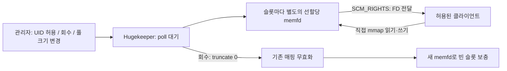

# Hugekeeper

미리 확보한 거대 페이지 메모리를 필요한 프로세스에 빌려주고 회수하는 작은 Linux 서비스입니다.
명시적으로 예약하는 **2 MiB HugeTLB 페이지** 위에 큰 테이블·버퍼를 놓을 수 있습니다.
데이터는 클라이언트가 직접 mmap으로 읽고 쓰며, 데몬은 권한·대여·회수만 관리합니다.

데몬은 C로 작성했으며 외부 런타임 의존성이 없습니다. Python SDK는 표준 라이브러리만 사용합니다.
Linux 5.14 이상, 64비트 환경이 대상입니다. 이 버전의 전용 huge page 크기는 2 MiB입니다.

## 사용법과 사용 용도

큰 고정 길이 테이블, 분석용 배열, 배치 처리 버퍼처럼 **한 번 확보해서 여러 번 읽고 쓰는 메모리**에
맞습니다. 2 MiB 페이지 개수로 전체 풀을 지정하고, 허용한 UID의 프로그램만 영역을 대여하게 한 뒤
반환·강제 회수·전체 해제를 할 수 있습니다. SQL 엔진 자체는 아니며, 기존 프로그램이 C/Python SDK로
받은 영역에 자신의 자료구조를 놓는 방식으로 통합합니다.

### 바로 실행

```sh
git clone https://github.com/studyreadbook4ever/myChangGo.git
cd myChangGo/261027hugePage
make
sh scripts/demo.sh
```

데모는 호스트 커널 설정을 변경하지 않는 `thp` 모드입니다. 16 MiB를 선할당하고,
10만 행의 고정 길이 테이블을 mmap에 작성·조회한 뒤 풀을 0으로 줄여 반환합니다.
데모 종료 시 데몬과 임시 소켓도 정리합니다.

직접 운영하려면:

```sh
mkdir -p "$HOME/.cache/hugekeeper"
chmod 700 "$HOME/.cache/hugekeeper"
./build/hugekeeperd --socket "$HOME/.cache/hugekeeper/pool.sock" \
  --pages 32 --backend thp --allow-uid "$(id -u)"
```

`--pages 32`는 **2 MiB 페이지 32개, 총 64 MiB**입니다. 숫자는 전체 풀 크기이며,
기본적으로 하나의 연속된 대여 영역을 만듭니다. 동시에 여러 대여를 처리하려면
`--pages 32 --slots 4`처럼 똑같은 크기의 4개 영역으로 나누세요. 페이지 수는 슬롯 수로
나누어떨어져야 하며, 총 메모리는 여전히 64 MiB입니다.

`--pages`를 생략하면 먼저 누락 사실을 알리고 다음을 표시합니다.

```text
No --pages parameter supplied. Reserve the maximum currently available 2 MiB pages? [y/N]
```

터미널에서 `y` 또는 `yes`를 직접 입력한 경우에만 최대 확보를 시도합니다. 대소문자는 구분하지
않습니다. Enter·다른 답변·EOF는 취소이고, 파이프·서비스 등 비대화형 실행은 페이지 수를 명시해야 합니다.
확인 전에는 메모리를 선할당하거나 소켓을 생성하지 않습니다. `--max-mib 64`처럼 명시적 상한을
함께 지정하면 최대 모드도 그 한도를 지킵니다.

HugeTLB 최대치는 현재 남은 2 MiB 페이지에서 이미 예약된 페이지를 뺀 값과 적용되는 프로세스·cgroup
한도로 계산합니다. THP/plain은 `MemAvailable` 및 cgroup 여유 중 작은 값에서
`max(128 MiB, 10%)`를 운영 여유로 남깁니다. 일반 메모리를 끝까지 채워 호스트나 cgroup의 OOM을
유발하는 것을 피하기 위한 명시적 규칙입니다. 최대 모드도 호스트의 HugeTLB 예약량을 변경하지 않습니다.
계산과 할당 사이에 다른 프로세스가 메모리를 사용할 수 있으므로 숫자는 시점 기준 추정치이며,
실제 확보량은 `READY`와 `STATUS.total_pages`로 확인합니다. 할당 실패 시 성공으로 표시하지 않습니다.
자동 계산에는 읽을 수 있는 cgroup v2 계층과 `/proc`, `/sys`가 필요합니다. 필수 한도를 확인할 수
없으면 자동 최대 모드는 실패하며, 이 경우 크기를 검토해 `--pages N`으로 명시하세요.

다른 터미널에서:

```sh
export PYTHONPATH="$PWD/python"
python3 -m hugekeeper --socket "$HOME/.cache/hugekeeper/pool.sock" status
python3 -m hugekeeper --socket "$HOME/.cache/hugekeeper/pool.sock" demo
python3 -m hugekeeper --socket "$HOME/.cache/hugekeeper/pool.sock" free
```

`free`는 활성 대여도 즉시 무효화하고 **풀 전체를 OS로 반환**합니다. 대여 중인 프로그램이
더 이상 포인터를 사용하지 않도록 먼저 정리하세요. 서비스는 계속 살아 있으며 정책을 유지합니다.
HugeTLB는 커널의 예약 풀로 반환합니다. 그 예약 풀을 일반 RAM으로 바꾸는 `nr_hugepages` 변경은
수행하지 않습니다. THP/plain은 일반 메모리로 반환합니다.
활성 대여를 보존하면서 빈 풀만 해제하려면 `resize 0`을 쓰면 됩니다. 사용 중인 대여가 있으면 실패합니다.

Python 패키지는 `python3 -m pip install .`로 설치할 수도 있습니다.
기본 백엔드는 엄격한 `hugetlb`입니다. 페이지가 없으면 시작에 실패하며 THP로 자동 전환하지 않습니다.

C/C++에서는 `include/hugekeeper.h`와 `build/libhugekeeper.a`를 사용합니다.

```c
#include "hugekeeper.h"

struct hk_lease lease = HK_LEASE_INIT;
if (hk_acquire("/run/hugekeeper/pool.sock", &lease) == 0) {
    /* lease.data / lease.size를 테이블이나 버퍼로 사용합니다. */
    ((char *)lease.data)[0] = 42;
    hk_release(&lease); /* 모든 포인터 사용을 마친 뒤 반환 */
}
```

`build/table-demo /소켓/경로`는 C 라이브러리로 테이블을 채우고 검색·스캔하는 예제입니다.
`cc -Iinclude your_app.c build/libhugekeeper.a -o your_app` 형태로 링크할 수 있습니다.

### 프로그램에서 대여하고 반환하기

```python
from hugekeeper import Lease, admin_request

path = "/run/hugekeeper/pool.sock"
with Lease(path) as lease:
    lease.mapping[:5] = b"hello"
    assert lease.mapping[:5] == b"hello"
    # memoryview / NumPy 등 외부 버퍼는 이 블록을 나가기 전에 해제하세요.

admin_request(path, "RESIZE 8")
```

하나의 연결은 하나의 슬롯을 독점 대여합니다. 슬롯 내부의 자료구조나 세부 할당은 애플리케이션이
관리합니다. 슬롯 크기는 시작할 때 결정하며 슬롯 개수는 실행 중 변경할 수 있습니다.
최대 32슬롯, UID 정책 32개, 데이터 연결 112개, 관리 연결 16개를 지원합니다.
실행 중 증설 상한은 기본적으로 1 GiB와 시작 시 요청량 중 큰 값이며 `--max-mib`로 직접 지정할 수 있습니다.
FD 한도가 낮으면 연결 한도를 줄여 관리 연결과 메모리 FD를 위한 여유를 남깁니다.
고급 호환 옵션 `--slots N --slot-mib M`도 지원하며 명시적 크기 지정으로 취급하므로 확인창을 띄우지 않습니다.

| 작업 | 관리 명령 | 효과 |
| --- | --- | --- |
| 허용 | `ALLOW <uid>` | 해당 UID의 이후 대여 허용 |
| 차단 | `DENY <uid>` | 이후 대여 차단 + 현재 대여 강제 회수 |
| 개별 회수 | `REVOKE <lease>` | 해당 대여 매핑 즉시 무효화 |
| 풀 크기 조절 | `RESIZE <slots>` | 유휴 메모리 증감; 활성 대여 수보다 작으면 실패 |
| 재보충 | `REFILL` | 할당 실패로 비어 있는 슬롯 재시도 |
| 전체 해제 | `FREE` | 활성 대여도 무효화하고 풀 전체를 OS로 반환 |
| 상태 | `STATUS` | 대여·예약·실제 매핑 메모리 통계 |

`ALLOW`가 없는 UID는 기본 거부됩니다. `--allow-uid`를 반복 지정하거나 관리 명령을 사용하세요.
정책과 데이터는 메모리에만 존재하며 재시작 시 보존하지 않습니다.

## 효능

- **데이터 접근 경로가 짧습니다.** 대여 후에는 클라이언트가 mmap 메모리를 직접 읽고 씁니다.
  매번 데몬에 데이터를 보내거나 복사하지 않습니다. 유휴 데몬은 이벤트가 올 때까지 잠듭니다.
- **할당 비용을 사용 전에 치릅니다.** 페이지를 실제로 채운 뒤 대여하므로 첫 쓰기에 필요한 물리
  페이지 할당·초기화를 풀 준비 단계에서 수행합니다. 클라이언트의 mmap 페이지 테이블 구성 비용까지
  없어지는 것은 아닙니다.
- **필요할 때 접근과 용량을 회수합니다.** UID 차단, 개별 대여 회수, 풀 전체 해제를 지원합니다.
  다음 대여에는 새 memfd를 사용하므로 이전 FD로 다음 사용자의 메모리에 접근하지 못합니다.

이번 최적화에서 직접 측정한 변화는 다음과 같습니다. 같은 호스트에서 변경 전후 실행 순서를
번갈아 비교한 결과이며, 모든 환경이나 SQL 쿼리에 적용되는 수치는 아닙니다.

| 측정 항목 | 결과 | 해석 |
| --- | --- | --- |
| `STATUS` 응답 지연 | plain 2 MiB, THP 2/16 MiB에서 중앙값 약 **23~27% 감소** | 세 조건 모두 6회 비교에서 개선; plain 16 MiB는 변동이 커 개선을 단정하지 않음 |
| `DENY` 시 마지막 대여 FD의 무효화 관측 지연 | 128 MiB 풀에서 plain 약 **80%**, THP 약 **99% 감소** | 모든 대상 회수를 먼저 끝내고 보충하도록 변경; 클라이언트 mmap 없이 FD 크기로 측정 |
| 일반 반환·재보충 완료 지연 | 일관된 개선을 입증하지 못함 | 큰 페이지의 초기화·회수 비용은 계속 발생 |

거대 페이지의 TLB 효율 개선은 워크로드와 실제 페이지 구성에 따라 달라집니다. 이 프로젝트가
특정 DB의 처리량이나 쿼리 지연을 개선했다고 주장하지 않습니다. 측정 조건, 원자료, 재현 방법과
제약은 [최적화 검증 기록](docs/optimization.md)에 있습니다.

## 이론

### 왜 2 MiB 페이지인가

4 KiB 기본 페이지를 쓰는 환경에서 2 MiB는 기본 페이지 512개에 해당합니다. 큰 페이지로 매핑하면
같은 주소 범위를 표현하는 페이지 테이블과 TLB 항목 수를 줄일 수 있습니다. 큰 테이블을 반복해서
탐색할 때 유리할 수 있지만, 캐시 적중률·접근 패턴·메모리 대역폭 등에 따라 실제 효과가 달라집니다.
HugeTLB는 미리 예약한 전용 풀을 사용하며, THP는 커널이 일반 메모리를 큰 페이지로 구성하는 방식입니다.

이 프로그램은 그 메모리의 대여 수명을 관리합니다. 예약된 용량의 유지, 사용자 접근 허용,
오래된 매핑의 무효화는 서로 다른 작업이며 아래 구조로 처리합니다.

### 메모리와 회수 구조



대여 시 파일 디스크립터 하나를 Unix `SOCK_SEQPACKET`으로 전달합니다. 매핑 후 데이터 읽기·쓰기는
직접 메모리 접근이고 데몬 RPC·복사·중재가 없습니다. 데몬은 단일 스레드이며 이벤트가 없으면
`poll(..., -1)`에서 잠듭니다. heartbeat나 주기적 메모리 스캔은 없습니다.

회수 시 이전 inode를 0바이트로 잘라 매핑을 무효화하고, 새 memfd를 만들어 선할당합니다.
`F_SEAL_GROW | F_SEAL_SEAL`이 적용되어 이전 FD의 재확장이나 회수 방해용 seal 추가는 거부됩니다.
이전 inode를 다음 사용자에게 재사용하지 않으므로 오래된 FD로 다음 대여자의 데이터를 읽지 못합니다.
재보충에 실패하면 해당 슬롯은 `degraded`로 표시되고 대여되지 않습니다.

`DENY`는 해당 UID의 모든 대여를 먼저 무효화한 다음 빈 슬롯을 보충합니다. 첫 슬롯의 큰 메모리를
초기화하는 동안 다른 대상의 접근이 계속 남아 있지 않도록 회수와 보충을 두 단계로 처리합니다.
실제 매핑을 확인하는 `STATUS`도 `/proc/self/smaps`의 필요한 항목만 파싱합니다.
변경 전후 교차 측정과 회귀 검증은 [최적화 기록](docs/optimization.md)에 있습니다.

선할당과 회수·재보충은 페이지 수에 비례하는 비용이 있습니다. 작은 객체마다 대여하는 용도가 아니라,
큰 테이블·배치 작업·버퍼 영역을 한 번 빌려 여러 번 사용하는 용도에 맞습니다.

### 백엔드 선택과 실제 메모리 확인

| 백엔드 | 특성 |
| --- | --- |
| `hugetlb` | 예약한 2 MiB HugeTLB 페이지 사용, swap 불가, 기본값, 미확보 시 시작 실패 |
| `thp` | shmem에 `MADV_HUGEPAGE`; 실제 거대 페이지 사용은 커널 정책·메모리 상태에 따름 |
| `plain` | `MADV_NOHUGEPAGE`; 비교·진단용 기본 페이지 모드 |

모든 모드는 `MADV_POPULATE_WRITE`로 페이지를 실제로 채운 뒤 대여합니다. THP/plain은 swap 가능하며
상주 보장이 필요하면 `--lock`을 사용하세요. `mlock` 권한·한도가 부족하면 시작에 실패합니다.
`STATUS`의 `pool_bytes`는 슬롯 용량이고 `resident_bytes`는 해당 매핑의 관측된 상주량입니다.
`hugetlb_bytes`는 명시적 HugeTLB 매핑, `thp_mapped_bytes`는 `ShmemPmdMapped` 합계입니다.
`page_bytes`, `total_pages`, `ready_pages`, `leased_pages`로 2 MiB 페이지 단위의 용량도 확인합니다.
THP 모드를 선택했다는 사실만으로 전부 huge page라고 보고하지 않습니다.
`memory_observed=false`이면 `/proc/self/smaps`를 읽지 못한 것입니다.

```sh
python3 scripts/doctor.py
```

전용 HugeTLB 운영에는 관리자가 먼저 페이지를 예약해야 합니다. 예를 들어 새로 구성하는 호스트에서
64 MiB에 해당하는 2 MiB 페이지 32개를 목표로 할 수 있습니다. 기존 풀을 운영 중이면 그 용량을
포함해 목표를 계산하세요. 런타임 예약은 단편화 때문에 요청보다 적게 성공할 수 있으므로
`/proc/meminfo`의 `HugePages_Total/Free`를 확인해야 합니다.
커널의 `vm.nr_hugepages`, `vm.hugetlb_shm_group` 또는 서비스의 `CAP_IPC_LOCK` 설정을 이용합니다.
프로젝트가 이 시스템 설정을 자동 변경하지는 않습니다.

`systemd/hugekeeper.service`는 전용 `hugekeeper` 계정을 전제로 한 설치 예제입니다.
`make install`은 바이너리·C 라이브러리·헤더·README를 설치하며 계정·페이지 예약·서비스 활성화는 수행하지 않습니다.
서비스의 기본 정책은 모두 거부입니다. 실제 작업 UID를 `ExecStart`의 `--allow-uid`로 추가하거나,
서비스 UID로 관리 소켓에 접속해 허용하세요. 여러 UID가 접속하려면 소켓 디렉터리를 0755로 두세요.

### 접근 제어와 수명 경계

- 커널이 제공하는 `SO_PEERCRED`의 UID로 권한을 검사합니다. 같은 UID의 여러 프로세스는 같은
  신뢰 영역입니다. PID별 격리 도구가 아닙니다. 다른 사용자로부터 격리하려면 전용 서비스 UID를 쓰세요.
- 관리 소켓은 0600이고 데몬 UID만 명령을 수행합니다. 데이터 소켓은 0666이며 UID 정책으로
  대여를 통제합니다. 부모 디렉터리는 데몬 소유이며 그룹·다른 사용자 쓰기가 금지되어야 합니다.
- `PR_SET_DUMPABLE=0`으로 데몬 `/proc/PID/fd` 경유 접근을 제한합니다. root나 권한 있는 디버거를
  차단하는 보안 경계는 아닙니다. 허용된 클라이언트의 디버깅·덤프 정책은 그 클라이언트가 관리합니다.
- 허용된 프로세스는 FD나 연결을 다른 프로세스로 넘길 수 있습니다. 이미 복사한 데이터는 회수할 수
  없습니다. 클라이언트는 자신의 writable FD를 축소하거나 hole-punch할 수 있고 자신의 대여를 손상시킬 수 있습니다.
- `REVOKE`, `DENY`, 정상 종료는 파괴적입니다. 이후 해당 매핑에 접근하면 **SIGBUS로 프로세스가
  종료될 수 있습니다**. 정상 반환은 사용을 마치고 unmap한 다음 `RELEASE`하는 순서입니다.
  Python SDK는 살아 있는 memoryview가 있으면 `BufferError`를 내고 대여를 유지합니다.
- 연결 종료 시 회수합니다. `fork`나 FD 전달로 연결 복제본이 남아 있다면 마지막 연결 참조가 닫힐 때
  회수됩니다. SDK 대여를 fork 이후 공유해서 사용하지 마세요.
- SIGINT/SIGTERM 종료는 모든 슬롯을 무효화합니다. **SIGKILL·데몬 충돌은 이미 전달한 FD를 회수하지
  않습니다.** 해당 memfd를 가리키는 모든 FD와 매핑 참조가 해제되어야 메모리가 반환됩니다. 비정상 종료 뒤 남은 소켓은
  관리자가 실행 중인 데몬이 없음을 확인한 뒤 지워야 합니다. 살아 있는 기존 소켓을 자동 삭제하지 않습니다.
- HugeTLB 회수 시 페이지는 잠깐 커널의 전역 풀로 돌아갑니다. 다른 소비자와 경쟁하면 재보충이
  실패할 수 있습니다. 고정 용량의 영구 독점 예약과 강제 FD 회수를 동시에 보장하지 않습니다.

### 테스트와 측정

```sh
make test
make sanitize
make clean all                 # sanitizer 없는 배포 빌드로 복구
python3 scripts/benchmark.py --help
python3 scripts/stress.py --help
./scripts/vm-test.sh           # KVM + QEMU + 읽을 수 있는 호스트 커널 필요
```

최신 실행 기록은 `results/`, 설명은 `docs/optimization.md`, 초기 검증은 `docs/validation.md`,
프로토콜은 `docs/protocol.md`에 있습니다.
VM 검증은 제한된 메모리의 별도 게스트 안에서만 HugeTLB 풀을 구성하며 호스트 설정은 유지합니다.
대여 및 회수 지연, idle CPU, 메모리 접근을 구분해서 측정합니다. 특정 SQL 엔진의 성능 향상은
그 엔진을 통합한 뒤 별도 워크로드로 측정해야 합니다.

### 설계 근거

- [Linux HugeTLB 문서](https://www.kernel.org/doc/html/latest/admin-guide/mm/hugetlbpage.html)
- [cgroup v2 메모리·HugeTLB 한도](https://docs.kernel.org/admin-guide/cgroup-v2.html)
- [memfd_create](https://man7.org/linux/man-pages/man2/memfd_create.2.html)
- [파일 sealing](https://man7.org/linux/man-pages/man2/F_ADD_SEALS.2const.html)
- [Unix 소켓과 자격·FD 전달](https://man7.org/linux/man-pages/man7/unix.7.html)
- [MADV_POPULATE_WRITE](https://man7.org/linux/man-pages/man2/madvise.2.html)
- [hugetlbfs truncate 구현](https://github.com/torvalds/linux/blob/master/fs/hugetlbfs/inode.c)

MIT License.
